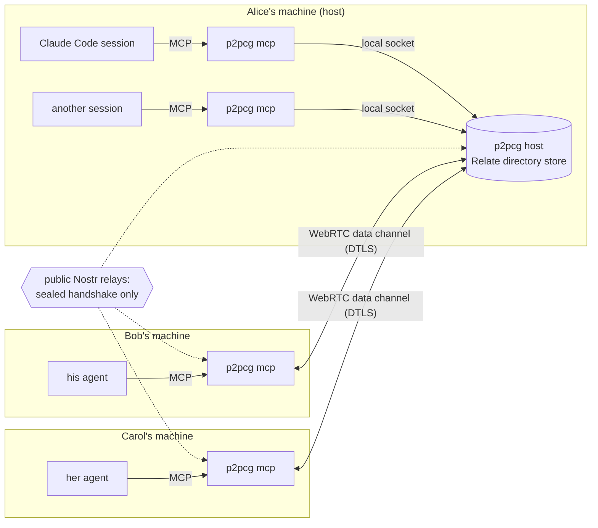

# p2p-context-graph

Share one [Relate](https://relatedb.ai/) context graph between several people's AI agents, peer to peer, with no server.

```bash
git clone https://github.com/CraigDeverall/p2p-context-graph && cd p2p-context-graph
npm install && npm run build
node dist/cli.js demo
```

`demo` opens the views in your browser on two example graphs (a copy; nothing
is changed). No account, API key or model download is needed.


## Use case

When three people investigate the same problem with their own AI agents, each
agent learns things the others never see. Findings get repeated, contradictions
go unnoticed, and a week later nobody can say what the team believed when it
made a call.

p2p-context-graph gives the group one shared graph. One person hosts it on
their machine and shares a link; everyone else pastes the link into their
agent, the host approves them, and from then on every agent reads and writes
the same graph, through tools defined by the graph's **context model**.

The relationships are what make it useful, because they answer the questions a
group actually asks:

| Question | Relationships that answer it |
|---|---|
| What do we believe now, and what did we believe on Tuesday? | `REPLACES` between claims, read *as of* any moment |
| Where do we disagree? | `CONTRADICTS` between claims that are both still current |
| Which questions are still open? | `ANSWERS` from a current claim |
| Which decisions need another look? | `RESTS_ON` an assumption since found false; `DEPENDS_ON` a superseded `Decision` |
| Why did we decide this, and what did we turn down? | `CHOSE` / `REJECTED` options with reasons |

Two context models are built in:
- `temporal-claims`: claims and questions.
- `decision-log`: decisions, options and assumptions.

The skill helps people write their own.

## How it uses Relate

- **Mode: directory.** Each graph is one Relate directory store (`@relate/relate`, embedded in the Node process through the C ABI).
- **Why this mode:**
  - A shared graph is long-lived and outlives every agent session.
  - One host process per graph owns the store while people come and go.
  - A directory keeps a write-ahead log, so every committed tool call is durable.
  - Anyone can open the store with Relate's own CLI.

  In memory would lose the group's knowledge when the host stops. A single `.rl` file would suit shipping a snapshot, not a store that is written all day.
- **What the graph models:** each model pack defines it.
  - `temporal-claims`: `Claim` and `Question` nodes, linked by `SUPPORTS`, `CONTRADICTS`, `REPLACES`, `ANSWERS` and `ABOUT`.
  - `decision-log`: `Decision`, `Option` and `Assumption` nodes, linked by `SUPERSEDES`, `DEPENDS_ON`, `RESTS_ON`, `CHOSE` and `REJECTED`.
  - Every node and relationship records when it entered the graph and who recorded it, so any read can answer as of a past moment.

| Relate feature | Where it's used |
|---|---|
| Embedded directory store, one per graph | `src/core/graph.ts`; the host process owns it |
| Uniqueness constraints | each node type's `key` in `model.yaml` |
| Vector index and full-text index across labels | `search` in `model.yaml` (`search_embedding`, `search_text`) |
| Hybrid search: `SEARCH … COMBINE (VECTOR …, FULLTEXT …) USING WRRF` (preview `hybrid-search`) | the `search` tool in both packs |
| Temporal values and `EXISTS {}` subqueries | the *as of* reads: `beliefs`, `conflicts`, `open_questions`, `decisions`, `needs_review` |
| Pattern comprehensions and traversal | `needs_review`, `decisions`, `history`; the explorer's snapshot |
| Transactions (`begin` / `commit` / `rollback`) | every tool call is one transaction; a check step can roll it back |

## Setup and run

You need Node 20 or later. It's tested on macOS arm64 and, in CI, on Linux x64 and macOS. No compiler is needed: the native parts (Relate and node-datachannel) ship prebuilt binaries.

**1. See it** (the steps at the top): `node dist/cli.js demo`.
- In the browser, open *Explore the graph* and drag the time slider back to 10 Nov. Watch the conflict between Bob's and Carol's claims appear, then settle.
- *Conflicts* shows the two claims side by side.
- In *Model studio → Packs and graphs*, switch to `decisions`. A *Decisions that need review* tab appears: the gateway decision rests on an assumption Carol found false.

**2. Use it from your agent.** Add the MCP server to Claude Code:

```bash
claude mcp add p2p-context-graph -- node "$PWD/dist/cli.js" mcp
```

Then ask things like:
- *"record in the context graph that checkout p95 rose to 4 s at 13:58"*
- *"what open questions are there?"*
- *"open the graph explorer"*

Agents that support MCP Apps show the views inline. In other agents, ask for the *browser view*: the same views on 127.0.0.1.

To use the example data instead of a new graph, add `P2PCG_DATA_DIR=<the folder demo printed>` and `--graph incident`.

**3. Share it.**
1. **You:** create a graph (*"start a context graph called incident-42"*) or say *"share my context graph"*. Either gives you a `p2pcg://join/…` link straight away. Send it privately.
   Others see you by your git name until you change it (*"set my name to …"*, or *Change* in the console).
2. **Them:** paste the link into their agent. They see their name and a key fingerprint.
3. **You:** check the fingerprint with them. Approve them in the console, or with *"approve bob as a contributor"*.

From then on, their graph tools act on your graph, limited by their role (reader, contributor or admin).

**Check your machine** with `node dist/cli.js doctor`.

## Where the data lives

- **Example graphs in this repo:** [`examples/data/graphs/incident`](examples/data/graphs/incident) (temporal-claims) and [`examples/data/graphs/decisions`](examples/data/graphs/decisions) (decision-log).
  - They are ordinary Relate directory stores, built by [`scripts/make-examples.ts`](scripts/make-examples.ts) (`npm run examples`) from one scenario: three people investigating a checkout slowdown, then deciding what to do.
  - Open them with Relate's CLI:

    ```bash
    relate -d examples/data/graphs/incident "MATCH (a:Claim)-[:CONTRADICTS]->(b:Claim) RETURN a.text, b.text"
    relate -d examples/data/graphs/decisions "MATCH (d:Decision)-[:RESTS_ON]->(a:Assumption) WHERE a.invalidated_at IS NOT NULL RETURN d.text, a.text, a.invalidated_because"
    ```
- **Your own graphs:** `~/.local/share/p2p-context-graph/graphs/<name>` (set `P2PCG_DATA_DIR` to move them).
  - Next to them: `hosts/<name>/` holds the host's log and its list of approved people, and `identity.json` holds your key.

## How it works



- **One host process per graph** owns the Relate store. Every agent session on that machine is a client over a local socket, which only that user can open.
- **The host is the centre of a star.** Peers connect straight to it over WebRTC.
  - Only the connection handshake passes through public Nostr relays, sealed with a key derived from the link's secret.
  - The secret stays after the `#` and is never sent anywhere.
  - Joining needs both the secret (an HMAC proof) and an Ed25519 identity key, and the host approves each key once.
- **Peers only get the model's tools,** never raw Cypher or the host's admin operations. The host checks every call against the caller's role.
- **Context models are packs:**
  - `model.yaml` holds the shape.
  - `tools.yaml` holds parameterised Cypher, run in one transaction per call, with validated inputs.
  - `instructions.md` tells agents how to use the model.
  - `validate_model` runs every tool once on a scratch graph. The format is in [`references/model-packs.md`](plugin/skills/p2p-context-graph/references/model-packs.md).
- **MCP Apps:** five views (console, explorer, model studio, receipt with undo, conflicts) in one bundle. They're served as `ui://` resources, and on 127.0.0.1 behind a one-time token for agents that can't show views.

If two machines can't reach each other directly (some networks block it), set a TURN server: `P2PCG_ICE=turn:user:pass@host:3478`.

## Limits

- Relate 1.0 is new: this pins `@relate/relate` 1.0.1 and uses its `hybrid-search` preview.
- **Search embedder:** the default matches words and word fragments, not meaning. It runs offline with no model download, and the `Embedder` interface allows a semantic one later.
- **Tested connections:**
  - Peer-to-peer was tested between processes on one machine, over real public relays.
  - Networks with strict NAT need a TURN server.

## Built with

- [Relate](https://github.com/relatedb/relate) (Apache-2.0)
- [MCP TypeScript SDK](https://github.com/modelcontextprotocol/typescript-sdk) and [MCP Apps (ext-apps)](https://github.com/modelcontextprotocol/ext-apps)
- [node-datachannel](https://github.com/murat-dogan/node-datachannel) (WebRTC)
- [nostr-tools](https://github.com/nbd-wtf/nostr-tools) (event signing)
- Preact running React components
- zod, yaml, esbuild, tsup, vitest

Written with the help of Claude Code (Anthropic's AI coding agent).

## Licence

[Apache-2.0](LICENSE). Relate is a Neo4j Labs project, also under Apache-2.0.
This project is not affiliated with or endorsed by Neo4j.
