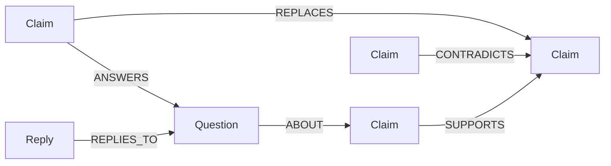
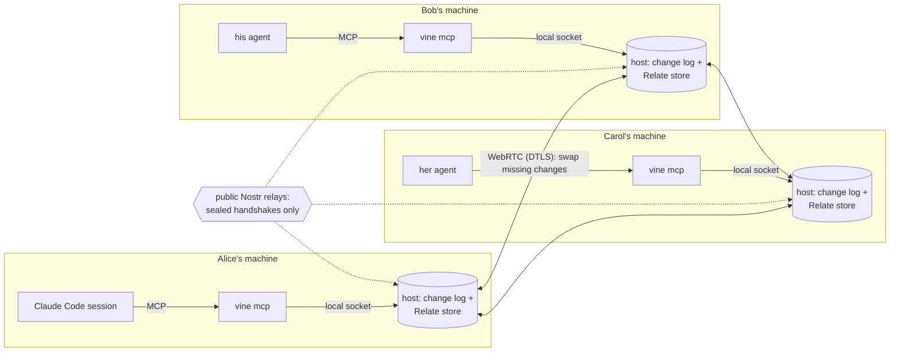

<h1 align="center"></h1>

<p align="center"><a href="https://github.com/CraigDeverall/vine-context/actions/workflows/ci.yml"></a></p>

**Shared memory for a team's AI agents.** One [Relate](https://relatedb.ai/) context graph of claims and questions, kept in step between everyone's machines, peer to peer, with no server.

```bash
npm install -g vine-context
claude plugin marketplace add CraigDeverall/vine-context
claude plugin install vine-context@vine-context
```

That installs the `vine` command and the Claude Code plugin. Then tell your agent *"start a context called incident-42"*, or look first with no agent at all:

```bash
vine demo
```

`demo` runs three members in one process: alice creates the example context, bob and carol join it with codes, and the three replay the planning of an office Christmas party, each writing through their own host and syncing peer to peer. Your browser shows alice's view of it, live. Nothing of yours is touched, and no network is needed. You need Node 20 or later, and no account, API key, compiler or model download.


<!-- Demo video: add the link here once it is recorded. -->

| If you want to… | Go to |
|---|---|
| Install it and try it | [Setup and run](#setup-and-run) |
| See what Relate does here | [How it uses Relate](#how-it-uses-relate), then [docs/RELATE.md](docs/RELATE.md) |
| Query the example graph yourself | [Where the data lives](#where-the-data-lives) |
| Use it with your own team | [docs/GUIDE.md](docs/GUIDE.md) |
| Understand the peer-to-peer design | [How it works](#how-it-works), then [docs/HOW-IT-WORKS.md](docs/HOW-IT-WORKS.md) |
| Judge it for the Relate hackathon | [docs/HACKATHON.md](docs/HACKATHON.md) |

## Use case

When three people work on the same thing with their own AI agents, planning the office Christmas party, say, each agent learns things the others never see. Findings get repeated, contradictions go unnoticed (one person has booked a room that another has found is too small), and a week later nobody can say what the team believed when it made a call.

Vine Context gives the group one shared graph of **claims** and **questions**.

1. One person creates a context and sends each teammate a join code.
2. Each teammate pastes the code into their agent and gets a full copy of the graph on their own machine.
3. From then on every agent reads and writes its own copy, and the machines swap what each is missing whenever they are online.

It keeps working offline, and when the person who created it is away.

**The relationships are the point.** An agent with this graph doesn't guess what the team thinks: it follows the links.

| What the team asks | Relationships that answer it |
|---|---|
| What do we believe now, and what did we believe on Tuesday? | `REPLACES` between claims, read *as of* any moment |
| Where do we disagree? | `CONTRADICTS` between claims that are both still current |
| Which questions are still open? | `ANSWERS` from a current claim to a question |
| What is this based on? | `SUPPORTS` chains, followed back to the evidence |
| What has been said about an open question? | `REPLIES_TO` from the messages in its thread |

**Who it's for:** a small group (up to about 20 people) working on the same thing, each with their own AI agent: an incident, a research question, a design decision, a project.

## How it uses Relate

- **Mode: directory.** Each context is one Relate directory store, embedded in a Node process with [`@relate/relate`](https://github.com/relatedb/relate). Nothing is deployed.
- **Why this mode.** A shared context outlives every agent session and is written all day, so it needs a durable store with a write-ahead log. An in-memory graph would lose the team's knowledge when the process stops. A single file suits shipping a snapshot, not a store that many sessions write through one long-lived process. A directory can also be opened by anyone with Relate's own CLI.
- **What the graph models.** `Claim`, `Question` and `Reply` nodes, linked by `SUPPORTS`, `CONTRADICTS`, `REPLACES`, `ANSWERS`, `ABOUT` and `REPLIES_TO`. Every node and relationship records when it entered the graph and who recorded it, so any read can answer *as of* a past moment. Nothing is deleted.
- **Every member has their own Relate store.** Each one is built by applying the same log of signed changes, so the same changes give the same graph on every machine, whatever order they arrived in.



The Relate features in use: an embedded directory store, uniqueness constraints, a vector index and a full-text index, hybrid search (`SEARCH … COMBINE (VECTOR …, FULLTEXT …)`), temporal values with `EXISTS {}` subqueries, pattern comprehensions, and transactions around every read and write. [docs/RELATE.md](docs/RELATE.md) shows where each one is used, with the Cypher.

## Setup and run

**Prerequisites:** Node 20 or later, and git. Tested on macOS arm64 and, in CI, on Linux x64, macOS and Windows x64. The native parts (Relate and node-datachannel) ship prebuilt binaries.

### 1. Install it

```bash
npx vine-context setup
```

One command sets the machine up, and repairs it if you run it again. It installs the `vine` command and the plugin for Claude Code or Codex (printing each command before it runs it), confirms your name, checks the machine and its network, sets up a TURN server if the network looks like it needs one, and offers autostart on macOS. `--dry-run` shows what it would do without changing anything.

<details><summary>By hand</summary>

```bash
npm install -g vine-context
claude plugin marketplace add CraigDeverall/vine-context
claude plugin install vine-context@vine-context
vine doctor
```

Codex and other MCP agents: see [the guide](docs/GUIDE.md#install-by-hand).

</details>

<details><summary>From a clone of this repo (no npm registry needed)</summary>

```bash
git clone https://github.com/CraigDeverall/vine-context.git
cd vine-context
npm ci
npm run build
npm link
vine demo
```

`npm link` puts this clone's `vine` command on your PATH, so the plugin steps above work with it too. `npm run check` runs the typecheck, the tests and the build, as CI does.

</details>

### 2. See it (about two minutes)

```bash
vine demo
```

Three hosts start in this process, one each for alice, bob and carol: alice creates the context, the other two join it with codes, and the story plays through them, one step every few seconds. Every write is signed by its author's host, held for undo, then carried to the other two over WebRTC, and the terminal says when each one arrives. In the browser page that opens, which is alice's view:

1. **Sharing console** shows the three members, their keys, roles and live links.
2. **Explore the graph** fills in as the changes arrive. Once the story is over, drag the time slider back to replay it: a conflict between bob's claim and carol's appears, then settles when bob replaces his claim.
3. **Conflicts** shows the two claims side by side while they contradict each other.

`--pace 1` runs it faster, `--pace 0` all at once. `--join` finds the members through the public Nostr relays instead of in this process, and prints a join code at the end, so your own agent (on this machine or another) can join as a fourth member and write into the same graph.

### 3. Use it from your agent

`vine setup` installed the plugin. It brings the MCP server, the skills and the `/vine-context:join` command, and in Claude Code a live panel beside the chat. Codex uses the same plugin, and any other MCP agent can run `vine mcp` directly: see [the guide](docs/GUIDE.md#install).

Then ask in plain words:

- *"Start a context called incident-42."*
- *"Record that 48 people are coming, from the RSVP sheet."*
- *"What open questions are there?"*
- *"Open the graph explorer."*

The agent only gets the model's tools (`add_claim`, `ask_question`, `link`, `search`, `beliefs`, `conflicts` and so on), never raw Cypher.

### 4. Share it

1. **You:** *"Invite Sam to my context."* Your agent gives you a line to send privately: `/vine-context:join vine1_…`
2. **Sam:** pastes it into their agent while your machine is online. They get a full copy and a briefing: what the context holds, the open questions, the conflicts.
3. **Everyone in the context is told** who joined. From then on, whatever anyone records reaches the others the next time their machines are online together.

Join codes, roles, undo, working offline and removing someone are covered in [the guide](docs/GUIDE.md).

## Where the data lives

**The example store is in this repo**, at [`examples/data/graphs/party`](examples/data/graphs/party): 8 claims (one withdrawn), 3 questions, 3 replies and 14 relationships. It is an ordinary Relate directory store, so [Relate's CLI](https://relatedb.ai/docs/get-started/install/) opens it:

```bash
cp -R "$(npm root -g)/vine-context/examples/data/graphs/party" /tmp/party
```

```bash
relate -d /tmp/party --mode table "MATCH (a:Claim)-[:CONTRADICTS]->(b:Claim) RETURN a.recorded_by, a.text, b.recorded_by, b.text"
```

Work on a copy, because Relate tidies a store's files when it opens one. In a clone of this repo the store is at `examples/data/graphs/party`. More queries to try, including *what did the team believe on Monday afternoon?*, are in [docs/RELATE.md](docs/RELATE.md#explore-the-example-store).

- The signed change log the store was built from: [`examples/data/hosts/party/changes.jsonl`](examples/data/hosts/party/changes.jsonl).
- The script that makes both: [`scripts/make-examples.ts`](scripts/make-examples.ts) (`npm run examples`).

**Your own contexts** live in `~/.local/share/vine-context/` (set `VINE_DATA_DIR` to move it): `graphs/<name>` is the Relate store, and `hosts/<name>/changes.jsonl` is its change log. [More detail](docs/HOW-IT-WORKS.md#files-on-your-machine).

## How it works



- **Every member has a full copy:** a log of signed changes and the Relate store built from it. Reads and writes always work, offline too.
- **A write is a signed change.** It is checked, applied locally, held for 10 seconds so *Undo* can truly remove it, then signed with the author's key and sent.
- **Machines swap what each is missing** over WebRTC. Changes are forwarded, so members who are never online together still get each other's writes.
- **Agents are told what a sync means for their person:** your claim was replaced, your question was answered, a new conflict appeared.
- **Agents are told without asking.** In Claude Code and Codex the plugin's hooks run `vine hook`: at the start of a session it tells the agent what the chat's context is for, and beside each prompt it passes on what other members' changes meant and a one-line reminder of where the chat records. Set `VINE_HOOKS=quiet` to drop the reminder, or `off` for none of it. Codex asks you to trust the hooks once (`/hooks`). Other agents get the same news in front of their next vine tool result.

The full account is in [docs/HOW-IT-WORKS.md](docs/HOW-IT-WORKS.md), and the design reasoning in [docs/REPLICATION.md](docs/REPLICATION.md).

## Limits

- **Search matches meaning with a small model that installs with vine,** on the CPU, offline. It has only been run on macOS arm64 so far; where its package isn't available or doesn't run, search matches words and word fragments instead, and `vine doctor` says which is in use.
- **Strict networks need a TURN server, on your own account.** Vine ships no shared TURN server or key. `vine setup` sets up Cloudflare's on your own Cloudflare account in a few steps (free up to 1,000 GB a month, far more than Vine uses), or you can use one you run. Only one machine in a pair needs one ([do I need a TURN server?](docs/GUIDE.md#do-i-need-a-turn-server)). Replication has been tested between processes on one machine and over real public relays.
- **Removing someone can't recall the copy they already have.**
- **Clocks are assumed correct,** and a context is sized for about 20 members and 100,000 changes.
- **Desktop only for now:** phones, and assistants that only reach remote MCP servers, can't connect yet.

Each is explained in [docs/HOW-IT-WORKS.md](docs/HOW-IT-WORKS.md#limits).

## More documentation

| Document | What it covers |
|---|---|
| [docs/GUIDE.md](docs/GUIDE.md) | Day-to-day use: the plugin, sharing, join codes, a chat's contexts, question threads, undo, staying in sync |
| [docs/RELATE.md](docs/RELATE.md) | The graph model, each Relate feature and where it is used, and queries to run on the example store |
| [docs/HOW-IT-WORKS.md](docs/HOW-IT-WORKS.md) | Hosts, signed changes, the mesh, join codes, files on disk, limits |
| [docs/REPLICATION.md](docs/REPLICATION.md) | The replication design and the decisions behind it |
| [docs/HACKATHON.md](docs/HACKATHON.md) | The Relate hackathon entry: how it meets each judging criterion, what is new, AI tools used |
| [docs/PLAN.md](docs/PLAN.md), [docs/spikes.md](docs/spikes.md) | The project's history: the original plan and the early experiments |

## Built with

- [Relate](https://github.com/relatedb/relate) (Apache-2.0)
- [MCP TypeScript SDK](https://github.com/modelcontextprotocol/typescript-sdk) and [MCP Apps (ext-apps)](https://github.com/modelcontextprotocol/ext-apps)
- [node-datachannel](https://github.com/murat-dogan/node-datachannel) (WebRTC)
- [nostr-tools](https://github.com/nbd-wtf/nostr-tools) (event signing)
- Preact running React components
- zod, yaml, esbuild, tsup, vitest

Written with the help of Claude Code (Anthropic's AI coding agent).

## Licence

[Apache-2.0](LICENSE). Relate is a Neo4j Labs project, also under Apache-2.0. This project is not affiliated with or endorsed by Neo4j.
