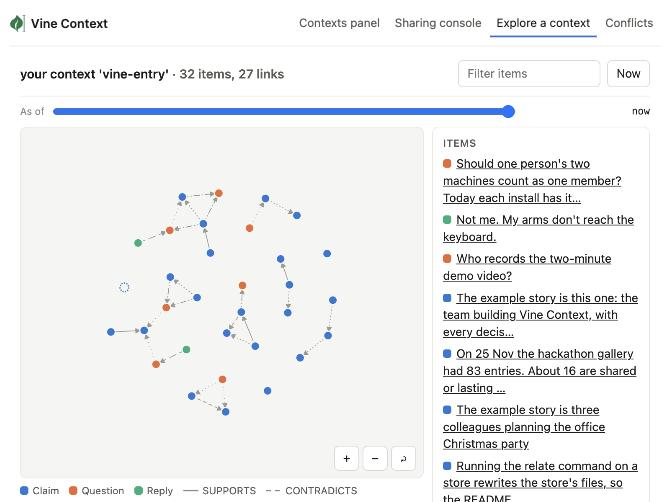
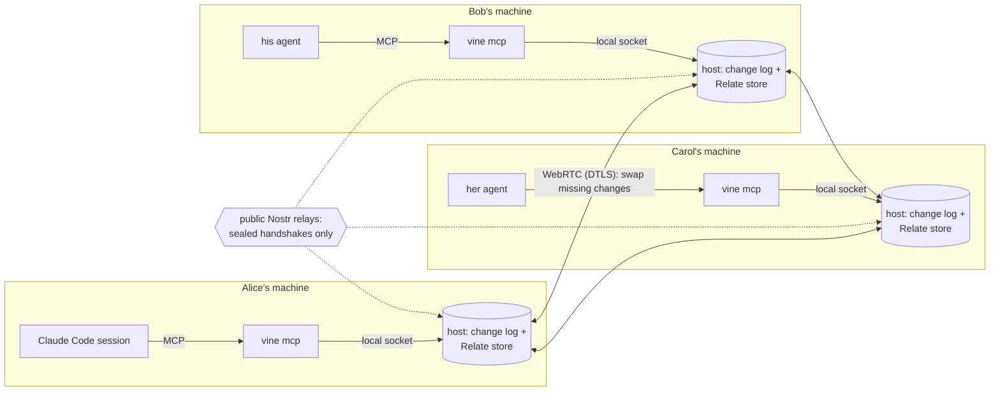

# Vine Context

Share one [Relate](https://relatedb.ai/) context graph between several people's AI agents, peer to peer, with no server. Every member keeps a full copy, and the members' machines keep each other in step.

```bash
git clone https://github.com/CraigDeverall/vine-context && cd vine-context
npm install && npm run build
node dist/cli.js demo
```

`demo` opens the views in your browser on an example context (a copy; nothing
is changed). No account, API key or model download is needed.



## Use case

When three people investigate the same problem with their own AI agents, each
agent learns things the others never see. Findings get repeated, contradictions
go unnoticed, and a week later nobody can say what the team believed when it
made a call.

Vine Context gives the group one shared graph of **claims** and
**questions**. One person creates it and sends each person a join code; they
paste it into their agent, get their own full copy, and everyone in the context
is told who joined. From then on every agent reads and writes its own copy,
and the members' machines swap what each is missing whenever they're online.
It keeps working offline, and when the person who made it is away.

The relationships are what make it useful, because they answer the questions a
group actually asks:

| Question | Relationships that answer it |
|---|---|
| What do we believe now, and what did we believe on Tuesday? | `REPLACES` between claims, read *as of* any moment |
| Where do we disagree? | `CONTRADICTS` between claims that are both still current |
| Which questions are still open? | `ANSWERS` from a current claim |
| What supports this? | `SUPPORTS` chains, followed by `history` and the explorer |

## How it uses Relate

- **Mode: directory.** Each graph is one Relate directory store (`@relate/relate`, embedded in the Node process through the C ABI).
- **Why this mode:**
  - A shared graph is long-lived and outlives every agent session.
  - One host process per graph, on each member's machine, owns its copy while sessions come and go.
  - A directory keeps a write-ahead log, so every applied change is durable.
  - Anyone can open the store with Relate's own CLI.

  In memory would lose the group's knowledge when the host stops. A single `.rl` file would suit shipping a snapshot, not a store that is written all day.
- **What the graph models:** one built-in model, Claims and Questions: `Claim` and `Question` nodes, linked by `SUPPORTS`, `CONTRADICTS`, `REPLACES`, `ANSWERS` and `ABOUT`.
  - Every node and relationship records when it entered the graph, who recorded it and their key, so any read can answer as of a past moment.
- **The store is built from a change log.** Each machine's Relate store is the result of applying the graph's signed changes; the same changes give the same store on every machine, whatever order they arrived in.

| Relate feature | Where it's used |
|---|---|
| Embedded directory store, one per graph | `src/core/graph.ts`; the host process owns it |
| Uniqueness constraints | each node type's `key` in `model.yaml` (ids are time-ordered UUIDs, so two machines never clash) |
| Vector index and full-text index across labels | `search` in `model.yaml` (`search_embedding`, `search_text`) |
| Hybrid search: `SEARCH … COMBINE (VECTOR …, FULLTEXT …) USING WRRF` (preview `hybrid-search`) | the `search` tool |
| Temporal values and `EXISTS {}` subqueries | the *as of* reads: `beliefs`, `conflicts`, `open_questions` |
| Pattern comprehensions and traversal | `history`; the explorer's snapshot |
| Transactions (`begin` / `commit` / `rollback`) | every read is one transaction; every applied change is one, and a write's checks run in one that is rolled back |

## Setup and run

You need Node 20 or later. It's tested on macOS arm64 and, in CI, on Linux x64 and macOS. No compiler is needed: the native parts (Relate and node-datachannel) ship prebuilt binaries.

**1. See it** (the steps at the top): `node dist/cli.js demo`.
- In the browser, open *Explore the graph* and drag the time slider back to 10 Nov. Watch the conflict between Bob's and Carol's claims appear, then settle.
- *Conflicts* shows the two claims side by side.
- *Sharing console* shows the three members, with their keys and roles.

**2. Use it from your agent.** Add the MCP server to Claude Code:

```bash
claude mcp add vine-context -- node "$PWD/dist/cli.js" mcp
```

Then ask things like:
- *"record in the context graph that checkout p95 rose to 4 s at 13:58"*
- *"what open questions are there?"*
- *"open the graph explorer"*

Agents that support MCP Apps show the views inline. In other agents, ask for the *browser view*: the same views on 127.0.0.1.

Where the views show:

- **Claude** (Claude Code desktop and Claude desktop): in the chat, and the console can stay open beside it. A receipt's *Explore graph* and *Console* buttons open those panels from it.
- **Codex app** (in the ChatGPT desktop app): in the chat, with a button to expand to full screen. There's no panel that stays open beside the chat.
- **Codex CLI and other terminal agents:** no views. Ask for the *browser view*.

**Or install the plugin** (skills, the `/vine-context:join` command and the MCP server, in one):

```bash
claude plugin marketplace add CraigDeverall/vine-context
claude plugin install vine-context@vine-context
```

**In Claude Code, the plugin also adds a mod** to Claude Code's own interface:
- a band above the prompt in every chat (*loading…* while it connects): this chat's context, who's online, and the latest news: what others' changes meant for you, or the latest thing someone synced (with *Open*);
- a status line entry, and a toast when someone else's change or a sync digest arrives;
- `/contexts`: a panel beside the chat, with four tabs. It updates by itself.
  - **Overview**: what needs you (claims that contradict each other, replies to your questions, open questions, a missing description, being offline), what others' changes meant for you, and the recent activity. *Catch me up* and *Save what this chat learned* ask your agent to do just that.
  - **Questions**: open, answered or yours, each with its thread. A question opens on its own, where *Answer* and *Answer with this* hand your answer to your agent to record as a claim, and *Ask my agent to look into it* sets it to work.
  - **Claims**: current, yours, in conflict, or history (replaced and withdrawn). A conflict shows both sides with *Keep this one*. A claim opens on its own with everything linked to it (evidence, what it answers, earlier versions), and *Correct it*, which your agent records as a claim that replaces it. *Undo* works while a write is still on your machine, *Withdraw* after.
  - **People**: who's in, what each has recorded and when they were last active; roles and *Remove* for admins; the join codes still waiting to be used, each with *Copy* and *Cancel*, and *Invite someone*; and *Go offline* / *Go online*.
  - Both lists filter by words, a person or an id. ✎ edits the description, and *⇄ Contexts* (or the context's name in the band) opens a view that turns the chat's contexts on and off. Editing something (a description, an answer, a correction, an invite, your name, a new context) takes the whole panel until it's saved or cancelled.
  - The panel never writes a claim or question itself: your agent does, from what you tell it.

The mod reads through the `context_activity` tool, which never uses up the join notices meant for your agent. Its source is [`plugin/hooks/register.tsx`](plugin/hooks/register.tsx); `claude plugin test plugin` runs its tests.

**In Codex**, the same `plugin/` folder is a Codex plugin (skills and the MCP server; Codex has no plugin slash commands or mods, so joining is the `join-context-graph` skill: paste the code, and the views show in the chat):

```bash
codex plugin marketplace add CraigDeverall/vine-context
codex plugin add vine-context@vine-context
```

The plugin starts the server with `vine mcp`, so the `vine` command must be installed first: from a clone, run `npm link` once.
Several context-graph servers can sit side by side (for example a second identity with its own `VINE_DATA_DIR` and `VINE_USER`, for testing joins); each is a separate person.

To use the example data instead of a new graph, add `VINE_DATA_DIR=<the folder demo printed>` and `--graph incident`.

**3. Share it.**
1. **You:** create a graph (*"start a context graph called incident-42"*) or say *"invite Sam to my context graph"*. Either gives you a join code straight away, as a line to send:
   `Join my context graph: /vine-context:join vine1_…`
   Send it privately, to that one person. Others see you by your git name until you change it (*"set my name to …"*, or *Change* in the console).
2. **Them:** run that command, or paste the code into their agent, while your machine is online (it answers the code). They're in straight away, with a full copy, and their agent gives them a briefing: what it holds, the open questions, the conflicts, the latest.
3. **Everyone in the context is told** who joined, on their agent's next action: name, role, which invite, who let them in, key fingerprint, agent and version, operating system. The console's *People* list shows the same. If it isn't who you expected, remove them (*"remove sam"*, or *Remove* in the console).

From then on everyone works on their own copy, limited by their role (contributor unless you said otherwise: *"invite Sam as a reader"*). Whatever anyone writes reaches the others the next time their machines are both online, directly or through any other member.

**Each code is for one person's machine.**
- Whoever uses it first is let in. Anyone else who uses it is turned away, and told to warn you that it may have leaked.
- There's no approval step: the single-use code is the credential, so send it privately.
- An unused code expires after 24 hours (*"invite Sam, valid for a week"* sets it).
- `sharing_status` and the console list the invites; `revoke_invite` or *Cancel* stops one working.
- A code isn't needed again: a joined context is on the member's machine, so *"use the incident-42 context"* (`use_context`) brings it back in any later chat.

**A chat's contexts.** A chat usually uses one context, and keeps it when you reopen the chat: it's remembered on your machine under the chat's id (Claude Code's session id, or `VINE_CHAT`), with nothing written into your project.
- *"Use the incident-42 context"* (`use_context`) sets or switches it; a new name starts a new context, and the agent asks what it's for (its description, which `describe_context` or ✎ in the panel changes).
- *"Also use the infra context"* (`add_context`) adds another; `remove_context` takes one out (or all). With several, reads search them all, and the agent puts each write in the one whose description fits.
- *"Delete the old-spike context"* (`delete_context`) deletes this machine's copy for good, after you confirm it by name; other members keep theirs. In the panel it's under a context's **Details**, beside its description, sharing state and where it's stored.
- There's no default: a new chat has none until you choose, so the agent asks before its first write, and the band shows *No context · Choose*.
- Optionally, pin contexts to a folder (`link_folder`; the 📌 on each context in the panel): new chats started in that folder, or below it, start with the pinned ones. That's kept on your machine too.

**Questions have threads.** Agents `reply` to a question with partial findings, ideas and follow-ups, and read the whole `thread` before adding to it. A reply never closes a question: when you give an answer (in the chat, or with *Answer* in the panel), your agent records it as a claim that `answers` the question.

**What a sync tells you.** When changes from others arrive (live, or catching up after being offline), each member's agent is told what they mean for that person:
- your claim was **replaced**, or your question **answered** or **replied to**;
- a **new conflict** (a claim contradicts another, yours first);
- **unsettled**: two current claims replace the same claim;
- a **possible overlap**: a new claim close to an existing one by someone else, with no link between them, for the agent to look at.

Nothing is linked automatically: the agent records SUPPORTS, CONTRADICTS or REPLACES with you.

**Undo really undoes, for 10 seconds.** A write stays on your machine for 10 seconds before it is sent: *Undo* on the receipt (or `take_back`) removes it without trace, so a slip such as personal details in the wrong chat never reaches anyone. After that it can only be *withdrawn*, which keeps it in everyone's history.

**Staying in sync.**
- Sharing is on by default and survives restarts. *"Stop sharing"* takes a context offline until you share again; your copy keeps working.
- Each graph's host runs while an agent uses it. To keep your graphs syncing without an agent open, and after a reboot, run `node dist/cli.js autostart on` (macOS: `vine up` at login).
- `vine status --graph <name>` shows the members, the live links to them, and whether the signalling relays are reachable.

**Removing someone** stops every member's machine syncing with them and refuses their later changes. It can't take back the copy they already have.

**Check your machine** with `node dist/cli.js doctor`.

## Where the data lives

- **The example graph in this repo:** [`examples/data/graphs/incident`](examples/data/graphs/incident), with its change log in [`examples/data/hosts/incident/changes.jsonl`](examples/data/hosts/incident/changes.jsonl).
  - Built by [`scripts/make-examples.ts`](scripts/make-examples.ts) (`npm run examples`) from one scenario: three people investigating a checkout slowdown. Each change is signed by alice, bob or carol; the example ships alice's throwaway key, so the demo runs as her.
  - The store is an ordinary Relate directory store. Open it with Relate's CLI:

    ```bash
    relate -d examples/data/graphs/incident "MATCH (a:Claim)-[:CONTRADICTS]->(b:Claim) RETURN a.text, b.text"
    ```
- **Your own graphs:** `~/.local/share/vine-context/` (set `VINE_DATA_DIR` to move it).
  - `graphs/<name>`: the Relate store, built from the change log.
  - `hosts/<name>/changes.jsonl`: every change this machine has (signed, one per line); `group.json`: the graph's id and group secret (only members have it); `invites.json`, `sharing.json`, `host.log`.
  - `identity.json`: your key. Keep it private: it is you in every graph.

## How it works



- **Every member has a full copy.** On each machine, one host process per graph owns that copy: a log of signed changes and the Relate store built from it. Agent sessions reach it over a local socket, which only that user can open. Reads and writes always work, offline too.
- **Writes are signed changes.** A write is checked against the copy, applied at once, held for 10 seconds (Undo), then numbered, signed with the author's Ed25519 key and sent. Each author numbers their own changes 1, 2, 3, so "what I have" is one number per member, and catching up is sending what the other side lacks.
- **Same changes, same graph.** Applying is idempotent and order-independent: a link waits for both its ends, the earlier of two equal links or withdrawals is kept, and checks that depend on what one machine has seen run only when the change is made. Every machine checks each change's signature and its author's role at that time.
- **Membership is in the same log:** the creator, joins, role changes, renames and removals, each signed by an admin (a rename by the member). A membership change that arrives late makes a machine rebuild its store from the log, so all copies agree.
- **The mesh:** online members meet in a signalling room named and sealed with the group secret, and link to each other over WebRTC (up to 20 members). Links and relay connections are pinged and replaced when they go quiet, and reconnect forever. Changes are forwarded, so members who never meet still get each other's writes.
- **Join codes:** `vine1_<room>.<secret>`, one per invite, answered by the admin machine that made it. The newcomer proves the secret (HMAC) and its key (Ed25519), and receives the graph id, the group secret and the whole log.
- **Agents only get the model's tools,** never raw Cypher. Write tools in [`models/temporal-claims/tools.yaml`](models/temporal-claims/tools.yaml) only check; the change itself is applied by fixed code in [`src/core/graph.ts`](src/core/graph.ts).
- **MCP Apps:** four views (console, explorer, receipt with Undo, conflicts) in one bundle. They're served as `ui://` resources, and on 127.0.0.1 behind a one-time token for agents that can't show views.
- The design and its reasoning: [`docs/REPLICATION.md`](docs/REPLICATION.md).

If two machines can't reach each other directly (some networks block it), one of them sets a TURN server, which then carries that pair's connection. There's none by default: you bring your own.

- `vine turn set turn.example.org --user sam` asks for the password in the terminal and keeps it in a file only you can read (`--store keychain` uses the macOS Keychain or the Linux secret service; `--store env` keeps nothing and reads `VINE_TURN_PASSWORD`). `--tcp` and `--tls` pick how the server is reached.
- `vine turn show`, `vine turn test` and `vine turn clear` show, check and remove it; `vine doctor` checks it too.
- It applies to every context on the machine from the next connection on, with nothing to restart. `vine status` and the console say which links are direct and which are relayed.
- An agent can set the server and username (`set_turn_server`) but never takes the password: it's read from `VINE_TURN_PASSWORD`, or you run `vine turn set` yourself.

**STUN servers.** To find a route between two machines, Vine asks public STUN servers for each machine's public address: by default `stun.l.google.com:19302` and `stun.cloudflare.com:3478`. Those servers see your public IP address, nothing else. To use your own, or none, set `VINE_ICE` where vine runs (for Claude Code, in the environment it starts with), then stop each running context's host (`vine host stop --context NAME`) so it picks it up:

- `VINE_ICE=stun:stun.example.org:3478` uses only your STUN server.
- `VINE_ICE=stun:stun.example.org:3478,turn:user:pass@turn.example.org:3478` adds a TURN server too. `VINE_ICE` replaces both the default STUN servers and the `vine turn` setting, so a TURN server goes in the same list, with its password.
- `VINE_ICE=` (set but empty) uses no servers: machines connect only when they can reach each other directly, such as on the same network.

`vine turn show` says when `VINE_ICE` is in effect. There's no stored STUN setting: `vine turn set` only adds a TURN server alongside the default STUN servers.

## Limits

- Relate 1.0 is new: this pins `@relate/relate` 1.0.1 and uses its `hybrid-search` preview.
- **Search embedder:** the default matches words and word fragments, not meaning, and runs offline with no model download. An optional one matches meaning with a small sentence model on the CPU: in a checkout, with a Rust toolchain, run `npm run build:embedder`, then start vine with `VINE_EMBEDDER=bge-small` (or `minilm`). A prebuilt package per platform (`vine-context-embedder-<os>-<arch>`, about 56 MB installed) is built in CI but not published yet, and it has only been run on macOS arm64. Each machine makes its own vectors, so members of one context can differ; changing the setting rebuilds a graph's vectors the next time its host starts.
- **Tested connections:**
  - Replication was tested between processes on one machine, over real public relays, and between hosts in one process.
  - Networks with strict NAT need a TURN server.
- **Removal can't recall data:** a removed member keeps what they already received. Every other machine refuses their later changes and stops syncing with them; the group secret isn't changed, so they can still see that the group's signalling room is in use, but get nothing from it.
- **Clocks:** changes are ordered by their time, so members' clocks are assumed to be right.
- **Size:** made for groups of up to about 20, and logs of up to about 100,000 changes. A new member downloads the whole log.

## Built with

- [Relate](https://github.com/relatedb/relate) (Apache-2.0)
- [MCP TypeScript SDK](https://github.com/modelcontextprotocol/typescript-sdk) and [MCP Apps (ext-apps)](https://github.com/modelcontextprotocol/ext-apps)
- [node-datachannel](https://github.com/murat-dogan/node-datachannel) (WebRTC)
- [nostr-tools](https://github.com/nbd-wtf/nostr-tools) (event signing)
- Preact running React components
- zod, yaml, esbuild, tsup, vitest

Written with the help of Claude Code (Anthropic's AI coding agent).

## Licence

[Apache-2.0](LICENSE). Relate is a Neo4j Labs project, also under Apache-2.0.
This project is not affiliated with or endorsed by Neo4j.
