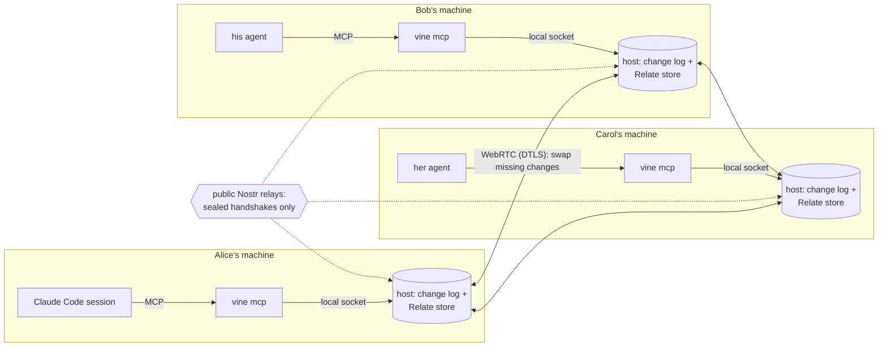

# How Vine Context works

The moving parts, in the order a change travels through them. The reasoning behind the design, and the alternatives that were dropped, are in [REPLICATION.md](REPLICATION.md).

Back to the [README](../README.md).

## Contents

- [The picture](#the-picture)
- [Every member has a full copy](#every-member-has-a-full-copy)
- [A write is a signed change](#a-write-is-a-signed-change)
- [Applying changes in any order](#applying-changes-in-any-order)
- [Members and roles](#members-and-roles)
- [The mesh](#the-mesh)
- [Join codes](#join-codes)
- [What agents can do](#what-agents-can-do)
- [The views](#the-views)
- [Files on your machine](#files-on-your-machine)
- [Limits](#limits)

## The picture

There is no server that holds the graph. The only shared infrastructure is public: STUN, and Nostr relays that carry sealed handshakes so machines can find each other.

## Every member has a full copy

On each machine, one **host** process per context owns that member's copy: a log of signed changes, and the [Relate](RELATE.md) store built from it.

Agent sessions come and go. Each one starts `vine mcp`, which reaches the host over a local socket that only that user can open. Reads and writes always work, offline too.

## A write is a signed change

When an agent calls a write tool such as `add_claim`:

1. The change is checked against the local copy.
2. It is applied at once, so the agent sees it.
3. It is held for 10 seconds. *Undo* in that time removes it without trace.
4. It is numbered, signed with the author's Ed25519 key, and sent.

Each author numbers their own changes 1, 2, 3. So "what I have" is one number per member, and catching up is sending what the other side lacks.

## Applying changes in any order

Applying a change is idempotent and order-independent:

- a link waits until both its ends have arrived;
- of two equal links or withdrawals, the earlier is kept;
- checks that depend on what one machine has seen run only when the change is made, not when it is replayed.

Every machine checks each change's signature and its author's role at that time. The result is that any two machines with the same changes hold the same graph, whatever order the changes arrived in.

## Members and roles

Membership lives in the same log: the creator, joins, role changes, renames and removals, each signed by an admin (a rename by the member).

A member is their machine's key. The name is a label and can change freely.

A membership change that arrives late makes a machine rebuild its store from the log, so all copies agree.

## The mesh

Online members meet in a signalling room named and sealed with the group secret, then link to each other directly over WebRTC data channels (DTLS), up to 20 members.

Links and relay connections are pinged and replaced when they go quiet, and reconnect for as long as the host runs. Changes are forwarded, so members who are never online together still get each other's writes through anyone who is.

Each machine learns its public address from public STUN servers (Google's and Cloudflare's by default). If two machines can't reach each other directly, a TURN server carries their link: `vine setup` or `vine turn set --provider cloudflare` sets up Cloudflare's on your own account (Vine mints short-lived credentials from your key at connect time), or `vine turn set` stores one you run, and `vine status` and the console say which links are relayed. See [Strict networks](GUIDE.md#turn-and-stun-on-strict-networks).

## Join codes

A code is `vine1_<room>.<secret>`, one per invite, answered by the admin machine that made it.

The newcomer proves it knows the secret (HMAC) and holds its key (Ed25519), and receives the graph id, the group secret and the whole log. Each code lets in one machine. [Using join codes](GUIDE.md#join-codes).

## What agents can do

Agents only get the model's tools, never raw Cypher.

- The tools are defined in [`models/temporal-claims/tools.yaml`](../models/temporal-claims/tools.yaml). Read tools run a fixed Cypher query with a row limit.
- Write tools only check. The change itself is applied by fixed code in [`src/core/graph.ts`](../src/core/graph.ts), the same way on every machine.
- Agents are told how to write well by [`models/temporal-claims/instructions.md`](../models/temporal-claims/instructions.md): search first, link instead of duplicating, never decide who is right in a conflict.
- After a sync, each agent gets a digest of what the changes mean for its person ([what a sync tells you](GUIDE.md#what-a-sync-tells-you)).

## The views

Four [MCP Apps](https://github.com/modelcontextprotocol/ext-apps) views ship in one bundle: the console, the explorer, the receipt with *Undo*, and conflicts.

They are served as `ui://` resources to agents that can show them, and on 127.0.0.1 behind a one-time token for agents that can't. The views never write to the graph themselves: they hand the action to the agent.

## Files on your machine

Everything is under `~/.local/share/vine-context/` (set `VINE_DATA_DIR` to move it).

| Path | What it is |
|---|---|
| `graphs/<name>` | The Relate directory store, built from the change log |
| `hosts/<name>/changes.jsonl` | Every change this machine has: signed, one per line |
| `hosts/<name>/group.json` | The graph's id and group secret. Only members have it |
| `hosts/<name>/invites.json`, `sharing.json`, `host.log` | Invites still waiting, the sharing setting, the host's log |
| `identity.json` | Your key. Keep it private: it is you in every context |

The example in this repo has the same layout under [`examples/data`](../examples/data). It ships Alice's throwaway key, so an agent can be pointed at it as her; `vine demo` makes fresh keys for its three members each time it runs.

## Limits

- **Relate 1.0 is new.** This pins `@relate/relate` 1.0.1 and uses its `hybrid-search` preview.
- **Search embedder.** By default (`VINE_EMBEDDER=auto`) search matches meaning with a small sentence model (bge-small) run on the CPU, offline. Its prebuilt package, `vine-context-embedder-<os>-<arch>` for macOS arm64 and x64, Linux x64 and arm64 (glibc) and Windows x64, is an optional dependency, so npm installs the one for your machine beside vine; it has only been run on macOS arm64. Where the package isn't installed or doesn't run, vine falls back to the built-in embedder, which matches words and word fragments, not meaning, and `vine doctor` says so. `VINE_EMBEDDER=hash` chooses the built-in one outright; `minilm` needs a checkout with a Rust toolchain and `npm run build:embedder`. Each machine makes its own vectors, so members of one context can use different embedders, and a graph opened with a different embedder makes its vectors again.
- **Tested connections.** Replication was tested between processes on one machine, over real public relays, and between hosts in one process. Networks with strict NAT need a TURN server, on your own account: Vine ships none ([do I need one?](GUIDE.md#do-i-need-a-turn-server)).
- **Removal can't recall data.** A removed member keeps what they already received. Every other machine refuses their later changes and stops syncing with them. The group secret isn't changed, so they can still see that the signalling room is in use, but get nothing from it.
- **Clocks.** Changes are ordered by their time, so members' clocks are assumed to be right.
- **Size.** Made for groups of up to about 20, and logs of up to about 100,000 changes. A new member downloads the whole log.
- **Platforms.** It runs as a local process, so it needs a desktop machine and an agent that can start a local MCP server. Phones, and assistants that only reach remote MCP servers over HTTPS, can't connect yet. Autostart is macOS only. The plan for these is in [PLAN.md, section 10](PLAN.md#10-target-any-device-any-assistant).
