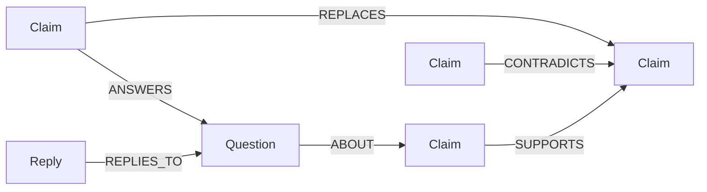
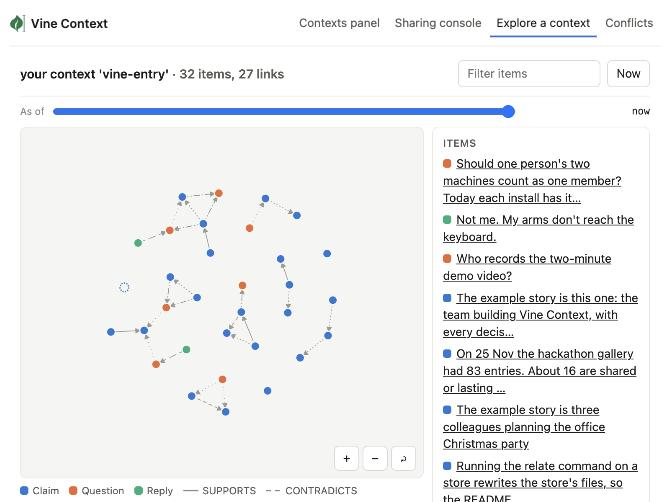

# How Vine Context uses Relate

[Relate](https://relatedb.ai/) is the embedded graph database under every context. This page shows what the graph models, which Relate features do the work, and queries you can run on the example store that ships in this repo.

Back to the [README](../README.md).

## Contents

- [Mode: directory](#mode-directory)
- [What the graph models](#what-the-graph-models)
- [Why relationships carry the use case](#why-relationships-carry-the-use-case)
- [Relate features and where they are used](#relate-features-and-where-they-are-used)
- [Explore the example store](#explore-the-example-store)
- [How agents reach the graph](#how-agents-reach-the-graph)

## Mode: directory

Each context is one Relate **directory store**, opened by `@relate/relate` inside a Node process. There is no database server.

| Mode | Fit for a shared context |
|---|---|
| In memory | No. The team's knowledge would be lost when the process stops. |
| Single file | Good for shipping a snapshot. Less suited to a store that a long-lived process writes all day. |
| **Directory** | **Yes.** It keeps a write-ahead log, so every applied change is durable, and anyone can open it with Relate's CLI. |

On each member's machine, one host process per context owns that member's store while agent sessions come and go. The store is not the source of truth on its own: it is the result of applying the context's log of signed changes ([how that works](HOW-IT-WORKS.md)). Delete a store and the host rebuilds it from the log.

## What the graph models

One model, **Claims and Questions**, defined in [`models/temporal-claims/model.yaml`](../models/temporal-claims/model.yaml).



| Node | What it is |
|---|---|
| `Claim` | One statement someone believes is true, in one or two sentences: a finding, a decision, a measurement |
| `Question` | Something the group needs to find out. It is answered when a current claim `ANSWERS` it |
| `Reply` | One message in a question's thread, before or instead of an answer |

| Relationship | Meaning |
|---|---|
| `(Claim)-[:SUPPORTS]->(Claim)` | The first claim is evidence for the second |
| `(Claim)-[:CONTRADICTS]->(Claim)` | The two can't both be true. A person should settle it |
| `(Claim)-[:REPLACES]->(Claim)` | The first is the newer version. The second stops being current from that moment |
| `(Claim)-[:ANSWERS]->(Question)` | The claim answers the question |
| `(Question)-[:ABOUT]->(Claim or Question)` | What the question asks about |
| `(Reply)-[:REPLIES_TO]->(Question)` | The reply belongs to this question's thread |

Every node and every relationship carries `recorded_at` and `recorded_by`. Nodes also carry the author's public key, and `withdrawn_at` if the author took them back. Nothing is deleted, so the graph can be read as it stood at any moment.

## Why relationships carry the use case

The questions a team asks are questions about how statements relate, not about any one statement.

- **"What do we believe?"** is every claim that no later claim `REPLACES` and that hasn't been withdrawn.
- **"Where do we disagree?"** is every `CONTRADICTS` between two claims that are both still current.
- **"What's still open?"** is every question with no current claim that `ANSWERS` it.
- **"Why do we think that?"** is the `SUPPORTS` chain behind a claim.
- **"What did we believe on Tuesday?"** is any of the above, counting only nodes and relationships recorded by Tuesday.

An agent without the graph would have to re-read every statement and guess which ones still stand. With it, the agent follows links that people and other agents recorded on purpose.

## Relate features and where they are used

| Relate feature | Where it is used |
|---|---|
| Embedded directory store, one per context | [`src/core/graph.ts`](../src/core/graph.ts); the host process owns it |
| Uniqueness constraints | Each node type's `key` in `model.yaml`. Ids are time-ordered UUIDs, so two machines never make the same one |
| Vector index and full-text index across labels | `search_embedding` and `search_text`, over `Claim` and `Question` |
| Hybrid search: `SEARCH … COMBINE (VECTOR …, FULLTEXT …) USING WRRF` (the `hybrid-search` preview) | The `search` tool, and the check for a new claim that overlaps an existing one |
| Temporal values and `EXISTS {}` subqueries | The *as of* reads: `beliefs`, `conflicts`, `open_questions` |
| Pattern comprehensions and traversal | `beliefs` and `history`; the explorer's snapshot |
| Transactions (`begin` / `commit` / `rollback`) | Every read is one transaction. Every applied change is one. A write's checks run in one that is rolled back |

The hybrid search query, from [`models/temporal-claims/tools.yaml`](../models/temporal-claims/tools.yaml):

```cypher
MATCH (n:Claim|Question) SEARCH n IN (COMBINE (
  VECTOR INDEX search_embedding FOR $query_vector LIMIT 100 WEIGHT 1,
  FULLTEXT INDEX search_text FOR $query_terms LIMIT 100 WEIGHT 1
) USING WRRF WITH CONSTANT 60 LIMIT 100) SCORE AS score
```

The embedder is a small sentence model (bge-small, 384 numbers) that installs with vine and runs on the CPU; where it isn't available, a built-in one makes a 256-number vector from words and word fragments ([limits](HOW-IT-WORKS.md#limits)).

## Explore the example store

The example is the building of this project: four people, 15 to 25 Nov 2026, and the decisions, changes of mind and breakages the project really went through. The cast is made up (all four are versions of the one Craig who built it with his agents). It holds 23 claims (one withdrawn), 7 questions, 2 replies and 27 relationships, of every kind.

Install [Relate's CLI](https://relatedb.ai/docs/get-started/install/), then work on a copy, because Relate tidies a store's files when it opens one.

```bash
cp -R "$(npm root -g)/vine-context/examples/data/graphs/vine-entry" /tmp/vine-entry
```

In a clone of this repo, copy `examples/data/graphs/vine-entry` instead.

**What's in it?** Seven `REPLACES`, six `ANSWERS`, six `ABOUT`, four `SUPPORTS`, two `CONTRADICTS` and two `REPLIES_TO`.

```bash
relate -d /tmp/vine-entry --mode table "MATCH ()-[r]->() RETURN type(r) AS relationship, count(*) AS n"
```

**Where did the team disagree?** Twice. Craigslist's reading of the rules (five criteria, weighted equally) contradicts the 100-point weights Craig recorded on the first day. And Craigslist's finding that the month's CI allowance was used up contradicts Craiginator's claim that a payment failed.

```bash
relate -d /tmp/vine-entry --mode table "MATCH (a:Claim)-[:CONTRADICTS]->(b:Claim) RETURN a.recorded_by AS who, a.text AS claim, b.recorded_by AS against, b.text AS other"
```

**Which disagreement is still open?** The one where neither claim has been replaced. Craiginator gave way on CI and replaced his claim, so that one is settled. Nobody could tell which judging weights hold, so that one is not.

```bash
relate -d /tmp/vine-entry --mode table "MATCH (a:Claim)-[:CONTRADICTS]->(b:Claim) WHERE NOT EXISTS { MATCH (:Claim)-[:REPLACES]->(a) } AND NOT EXISTS { MATCH (:Claim)-[:REPLACES]->(b) } RETURN a.text AS claim, b.text AS against"
```

**What did the team change its mind about, and who changed it?** Seven claims were replaced, four of them by someone other than their author. The biggest is the design itself: Craigosaurus Rex's one machine that hosts the graph gave way to Craig's full copy for every member.

```bash
relate -d /tmp/vine-entry --mode table "MATCH (new:Claim)-[r:REPLACES]->(old:Claim) RETURN old.recorded_by AS theirs, old.text AS was, new.recorded_by AS by, new.text AS now, r.recorded_at AS at"
```

**What changed more than once?** Follow `REPLACES` further. The search embedder went from hash-256, to a semantic one that could be switched on, to semantic by default.

```bash
relate -d /tmp/vine-entry --mode table "MATCH p=(:Claim)-[:REPLACES*2..]->(:Claim) RETURN [n IN nodes(p) | n.text] AS newest_first"
```

**Which questions are answered, and which are still open?** Four have answers. Three have none: which judging weights hold, who records the demo video, and whether one person's two machines should count as one member.

```bash
relate -d /tmp/vine-entry --mode table "MATCH (q:Question) OPTIONAL MATCH (c:Claim)-[:ANSWERS]->(q) RETURN q.text AS question, collect(c.text) AS answers"
```

**What was said in the threads?** A reply is a message in a question's thread, not an answer. One of these threads was later closed by a claim that answers its question. The other has only its reply, so the question stays open.

```bash
relate -d /tmp/vine-entry --mode table "MATCH (m:Reply)-[:REPLIES_TO]->(q:Question) RETURN q.text AS question, m.recorded_by AS who, m.text AS reply"
```

**What did the team believe on the Monday evening, before it changed its mind?** Only what had been recorded by then, and not yet replaced or withdrawn. At 18:00 on Monday 16 Nov, the graph still said one machine hosts the graph, search used hash-256, and a team could install its own model pack.

```bash
relate -d /tmp/vine-entry --mode table "WITH datetime('2026-11-16T18:00:00Z') AS T MATCH (c:Claim) WHERE c.recorded_at <= T AND (c.withdrawn_at IS NULL OR c.withdrawn_at > T) AND NOT EXISTS { MATCH (:Claim)-[r:REPLACES]->(c) WHERE r.recorded_at <= T } RETURN c.recorded_by AS who, c.text AS believed ORDER BY c.recorded_at"
```

Change the time to `2026-11-17T18:00:00Z` and the answer changes: every member keeps a full copy, and the model packs claim, withdrawn that afternoon, is gone.

The same store, seen in the explorer with `vine demo`:



The store was built by [`scripts/make-examples.ts`](../scripts/make-examples.ts) from the signed change log in [`examples/data/hosts/vine-entry/changes.jsonl`](../examples/data/hosts/vine-entry/changes.jsonl). The story itself is in [`src/demo/scenario.ts`](../src/demo/scenario.ts). `npm run examples` rebuilds both.

## How agents reach the graph

Agents never write Cypher. They get the model's tools over MCP, each with a described input, a row limit and a fixed query:

| Tool | What it does |
|---|---|
| `add_claim`, `ask_question`, `reply` | Record a claim, a question, or a message in a question's thread |
| `link` | Record `SUPPORTS`, `CONTRADICTS`, `REPLACES` or `ANSWERS` between two items (`ask_question` records `ABOUT`) |
| `withdraw` | Take back your own item. It stays in the history |
| `search` | Hybrid search over current claims and live questions |
| `beliefs`, `conflicts`, `open_questions` | What is current, where it conflicts, what is unanswered: now, or as of a given moment |
| `thread`, `history`, `recent` | A question's replies, every link into and out of one item (replaced and withdrawn ones too), the latest changes |

The tools are defined in [`models/temporal-claims/tools.yaml`](../models/temporal-claims/tools.yaml), and the guidance agents follow when writing is in [`models/temporal-claims/instructions.md`](../models/temporal-claims/instructions.md). Write tools only check a change. The change itself is applied by fixed code in [`src/core/graph.ts`](../src/core/graph.ts), the same way on every member's machine.
